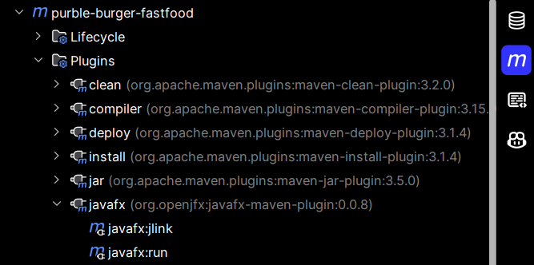
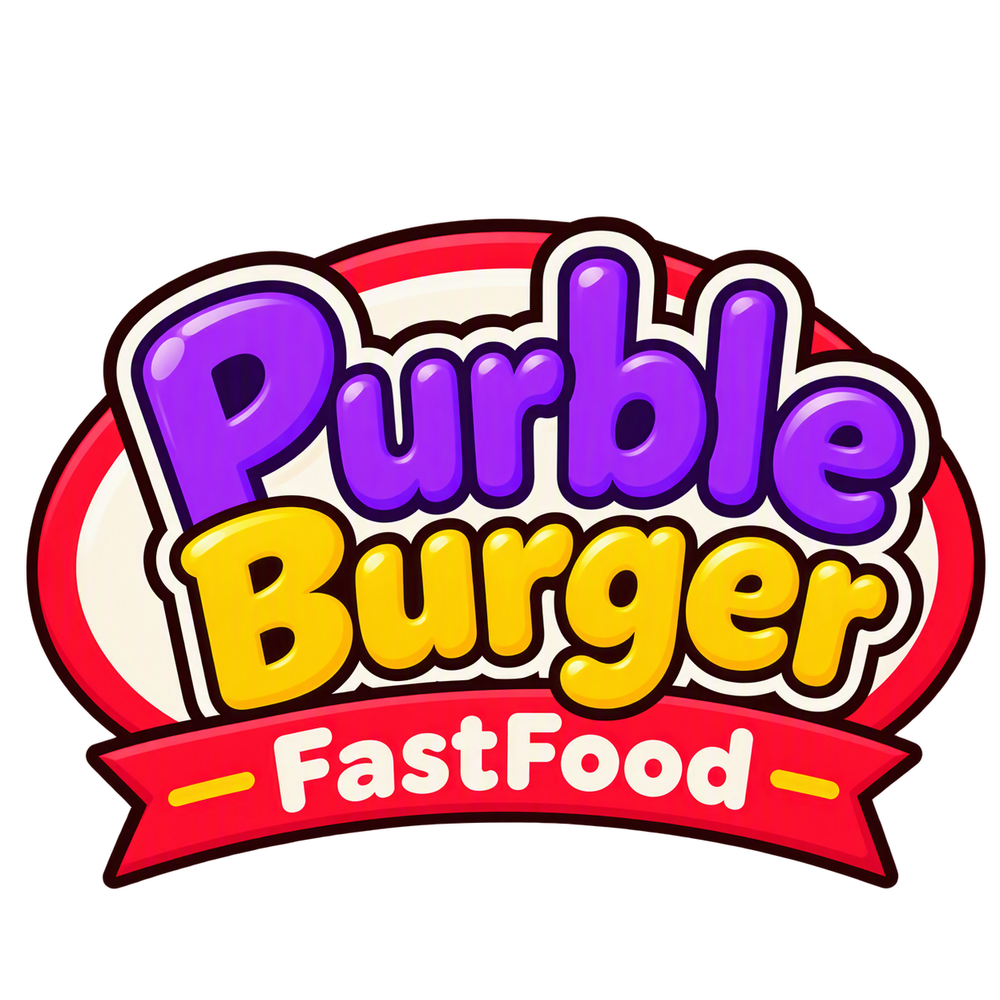

# 🍔 Purble Burger Fastfood

Developed as an individual project for a university course on
**Object-Oriented Programming**.

The user manages the kitchen of an automated fast-food
restaurant, with the goal of preparing and delivering the
precise sequence of sandwiches requested on a display within a limited time frame.

### Index
### Index
1. [How to Play and Game Mechanics](#1-how-to-play-and-game-mechanics)
    - [Ingredients, Buns and Sides](#-ingredients-buns-and-sides)
2. [Architecture and Design Decisions](#2-architecture-and-design-decisions)
3. [AI-Assisted Development](#3-ai-assisted-development)
4. [Requirements and How to Run](#4-requirements-and-how-to-run)
5. [Credits & License](#5-credits--license)

---

## 1. How to Play and Game Mechanics

### 🚀 Getting Started & Objective
- The game launches with a main start menu featuring a **"Play"** button.
- Once clicked, a **60-second countdown timer** begins immediately.
- The user must complete a maximum of **5 burger orders** per match before the time runs out.

#### 🍔 Burger Preparation
- Click on the available ingredients across the kitchen stations to assemble the requested sandwich.
- Use the **Left** and **Right** arrow buttons to move the tray back and forth along the conveyor belt to reach different dispensers.

#### 📦 Delivery & Scoring
- **Delivering an Order:** Click the green **"Deliver"** button once a sandwich is complete. If the assembled burger matches the target order on the display, a **star (★)** is added to the score.
- **Discarding Mistakes:** If a mistake is made during preparation, click the red **"Trash"** button to discard the sandwich and start fresh.

#### 🏆 Winning Conditions
- **Victory:** Earning **4 or 5 stars** within the 60-second limit results in a successful match (**"WELL DONE!"**).
- **Game Over:** Earning **3 stars or fewer** leads to a match loss (**"GAME OVER"**).

### 🍞 Ingredients, Buns and Sides

The kitchen offers various customization items distributed across the preparation stations:

- **Bread Shapes (Buns):**
    - `CLASSIC`: Traditional round bun.
    - `BAGEL`: Hole-in-the-middle round bun.
    - `BAGUETTE`: Elongated baguette bun.

- **Proteins & Fillings:**
    - `PATTY`: Beef patty reserved exclusively for **Classic** and **Bagel** orders.
    - `HAM`: Sliced ham used for **Baguette** and **Bagel** orders.
    - **Vegetables & Cheese:** Lettuce, Onion, Tomato and Pickles and Cheese (in a different dispenser).

- **Sides & Sauces:**
    - `FRIES`: Side portion of French fries.
    - `SAUCES`: Ketchup and Mustard (available only when fries are included in the order).
---

## 2. Architecture and Design Decisions

The application follows the **Model-View-Controller (MVC)** architectural pattern to ensure clean separation of concerns, high modularity, and maintainability.

### 🪜 Architecture Overview

The codebase is organized into four main packages:

- **`com.project.burger.model`**: Defines the core domain entities (`Burger`, `Ingredient`, `Order`, `BreadShape`, `IngredientType`). It contains no JavaFX dependencies and represents purely the data and domain rules.
- **`com.project.burger.engine`**: Manages the core game loop, state transitions (`GameState`), randomized order generation (`OrderGenerator`), and score tracking (`GameEngine`).
- **`com.project.burger.controller`**: Acts as the bridge between the UI and domain logic. Coordinates conveyor movement (`ConveyorController`), station actions (`StationController`), and main game flow (`MainController`).
- **`com.project.burger.view`**: Implements the JavaFX graphical interface (`MainApp`, `BurgerView`, `StationsView`, `OrderDisplayView`), rendering sprites and responding to user actions.

### 💡 Key Design Decisions

1. **Strict Decoupling of Logic and UI:**
   The game mechanics (evaluating if a completed burger matches an order) are executed strictly inside `GameEngine` and `Order.matches()`, ensuring the UI (`view`) only renders data without handling game rules.

2. **Dynamic Layering & Encapsulation:**
   The `Burger` model maintains ingredients in sequential order, allowing `BurgerView` to render layers dynamically from bottom to top bun based on the selected `BreadShape`.

3. **Domain-Driven Recipe Rules:**
   Specific culinary rules (e.g., assigning `HAM` exclusively to `BAGUETTE` orders, or linking sauce availability to `FRIES`) are encapsulated within `OrderGenerator` and `StationController` to preserve domain consistency.

### 🔧 Others

- **Build & Dependency Management (`pom.xml`):**
  The project is built using **Maven** as the single build tool. The `pom.xml` file configures **Java 21** compatibility, manages dependencies for **JavaFX 21** (graphics, controls, FXML), and integrates **JUnit 5** for automated testing.

- **Unit Testing & Domain Validation (`src/test/java/`):**
  Some files to verify core logic independently have been created:
    - `Launcher`: Ensures the application can launch properly.
    - `OrderDisplayTest`, `OrderDisplayBaguetteTest` and `OrderDisplayTestLauncher`: Test the visual stack of ingredients in the order display.

---

## 3. AI-Assisted Development

In accordance with the course guidelines, this project was developed using **AI-assisted coding tools**.

### 🤖 Tools & Workflow Integration

- **Gemini Plus Student (Core Development & Planning):**
  Used for the majority of the project, including high-level architectural design (MVC structure), defining domain logic, organizing package interactions, and writing technical documentation.

- **GitHub Copilot (IDE Integration):**
  Utilized directly within IntelliJ IDEA to accelerate initial class creation via custom prompts, handle boilerplate code and assist with specific targeted refactoring tasks.

- **Microsoft Copilot (Image Asset Generation):**
  Employed to generate 2D game asset visuals (src/main/resources/assets).

---

## 4. Requirements and How to Run

### 📋 Prerequisites

To build and run this application, ensure you have the following installed on your system:

- **Java Development Kit (JDK):** Version 21 or higher
- **Build Tool:** Apache Maven 3.9+

### 🚀 How to Run the Application

This project leverages the `javafx-maven-plugin` to handle JavaFX runtime modules and dependencies automatically.

1. **Clone the repository:** https://github.com/buffyval/purble-burger-fastfood.git
2. **Launch the game** by running the following single command from the project root directory: `mvn clean javafx:run`.
If this doesn't work, you can simply run the `Launcher` class from your IDE or you can also click on the *Maven* icon and follow the path shown in the image below and click `"javafx:run"` to launch the game.

---

## 5. Credits & License

- Developed by **Lucia Valerio** for the ***Programmazione ad Oggetti*** course of ***LT Ing. Informatica*** in ***Università di Modena e Reggio Emilia***.
- Inspired by *Purble Place / Comfy Cakes* by Microsoft. 
- This project is licensed under the **MIT License** — see the [LICENSE](LICENSE) file for details.

---
Have fun testing **Purble Burger Fast Food** and good luck assembling all the target orders in under a minute! 🍔⏱️

